# TP7 DPBO 2026 — PustakaVerse: Sistem Manajemen Perpustakaan & Sirkulasi Koleksi Berbasis OOP PHP dengan GUI

Repositori Tugas Praktikum 7 (TP7) mata kuliah **Desain dan Pemrograman Berorientasi Objek (DPBO)**, Program Studi Ilmu Komputer, Fakultas Pendidikan Matematika dan Ilmu Pengetahuan Alam, Universitas Pendidikan Indonesia, Tahun Ajaran 2025/2026.

---

## Janji

Saya **Riza Wahyu Nugraha** dengan **NIM 2511421** mengerjakan **Tugas Praktikum 7** dalam mata kuliah **Desain dan Pemrograman Berorientasi Objek** untuk keberkahan-Nya maka saya tidak melakukan kecurangan seperti yang telah dispesifikasikan. Aamiin.

---

## Daftar Isi

1. [Deskripsi Program & Tema Website](#deskripsi-program--tema-website)
2. [Pemenuhan Spesifikasi Tugas](#pemenuhan-spesifikasi-tugas)
3. [Teknologi yang Digunakan](#teknologi-yang-digunakan)
4. [Arsitektur & Konsep OOP yang Diterapkan](#arsitektur--konsep-oop-yang-diterapkan)
5. [Perancangan Basis Data (Database Design)](#perancangan-basis-data-database-design)
   - [Diagram Relasi Antar Tabel (ERD)](#diagram-relasi-antar-tabel-erd)
   - [Struktur Tabel & Atribut](#struktur-tabel--atribut)
6. [Struktur Direktori Proyek](#struktur-direktori-proyek)
7. [Penjelasan Kelas & Alur Eksekusi (Application Flow)](#penjelasan-kelas--alur-eksekusi-application-flow)
8. [Fitur & Operasi CRUD Seluruh Entitas](#fitur--operasi-crud-seluruh-entitas)
9. [Skenario Pengujian Fungsionalitas (Test Cases)](#skenario-pengujian-fungsionalitas-test-cases)
10. [Dokumentasi Antarmuka & Eksekusi Program](#dokumentasi-antarmuka--eksekusi-program)
11. [Panduan Setup & Menjalankan Program](#panduan-setup--menjalankan-program)
12. [Troubleshooting & FAQ](#troubleshooting--faq)

---

## Deskripsi Program & Tema Website

**PustakaVerse** adalah aplikasi web sistem manajemen perpustakaan modern (*Library & Circulation Management System*) yang dibangun menggunakan **PHP Native** murni dengan menerapkan prinsip-prinsip **Object-Oriented Programming (OOP)**, pemisahan lapisan logika (*Separation of Concerns*), dan antarmuka grafis (**GUI**) yang responsif, interaktif, dan modern.

Aplikasi ini mengelola 4 entitas relasional terintegrasi:
1. **Kategori Buku (`categories`):** Klasifikasi koleksi buku berdasarkan rumpun keilmuan dan penempatan lokasi rak fisik perpustakaan.
2. **Koleksi Buku (`books`):** Inventaris judul buku, nomor ISBN unik, penulis, penerbit, tahun terbit, kuantitas stok eksemplar fisik, cover visual, dan sinopsis. Berelasi langsung dengan entitas kategori (*Foreign Key*).
3. **Keanggotaan Perpustakaan (`members`):** Basis data sivitas anggota perpustakaan mencakup kode pengenal unik (*member code*), nama lengkap, kontak terverifikasi, alamat domisili, dan status keaktifan.
4. **Sirkulasi Peminjaman (`loans`):** Transaksi peminjaman dan pengembalian buku (*Circulation & Loan Tracking*) yang berelasi ganda (*Foreign Keys*) ke tabel buku dan anggota. Dilengkapi perhitungan denda keterlambatan dinamis dan otomasi mutasi kuantitas stok buku secara atomik (*Atomic Stock Adjustment*).

---

## Pemenuhan Spesifikasi Tugas

Berdasarkan dokumen panduan **Modul 8: OOP dalam Website PHP dengan GUI**, seluruh spesifikasi teknis dan kriteria penilaian telah dipenuhi 100%:

| No | Spesifikasi Tugas Praktikum 7 | Status | Implementasi pada Kode Proyek |
| :---: | :--- | :---: | :--- |
| 1 | **Tema Web Bebas & Berbasis OOP PHP** | ✅ | Mengembangkan **PustakaVerse** (Sistem Perpustakaan & Sirkulasi). Seluruh modul logika backend dibangun menggunakan paradigma *Class-Object* murni (`Database`, `Category`, `Book`, `Member`, `Loan`). |
| 2 | **Minimal 3 Entitas (3 Tabel)** | ✅ | Menyediakan **4 Entitas (4 Tabel)**: `categories`, `books`, `members`, dan `loans`. |
| 3 | **Minimal 1 Relasi Foreign Key** | ✅ | Mengimplementasikan **3 Foreign Key Constraints**: Relasi `books.category_id -> categories.id`, `loans.book_id -> books.id`, dan `loans.member_id -> members.id`. |
| 4 | **100% Prepared Statement (Anti-SQL Injection)** | ✅ | **Nol query mentah**. Seluruh operasi database di seluruh kelas menggunakan `PDO::prepare()` disusul `execute()` dan binding parameter terproteksi. Tidak ada pemanggilan fungsi query non-prepared (`mysqli_query()` atau `db->query()` mentah dilarang). |
| 5 | **CRUD Lengkap Setiap Entitas** | ✅ | Setiap entitas (`categories`, `books`, `members`, `loans`) dilengkapi operasi **Create, Read, Update, Delete** secara fungsional dan teruji. |
| 6 | **Struktur Folder Standar Modul 8** | ✅ | Mematuhi struktur folder baku modul: `class/`, `config/`, `database/`, `view/`, `style/`, dan `index.php`. |
| 7 | **Penyertaan File Database (.sql)** | ✅ | File skrip DDL & DML data awal tersedia pada file `database/db_pustaka_tp7.sql`. |
| 8 | **README Lengkap & Dokumentasi Eksekusi** | ✅ | Disusun komprehensif memuat dokumentasi arsitektur, ERD, flow sistem, panduan instalasi, tabel pengujian, tangkapan layar GUI (*screenshots*), dan demonstrasi animasi GIF. |

---

## Teknologi yang Digunakan

- **Bahasa Pemrograman:** PHP 8.x (PHP Native dengan OOP murni)
- **Database Engine:** MySQL 8.x / MariaDB (InnoDB Storage Engine)
- **Database Driver:** PHP Data Objects (PDO) dengan ekstensi `pdo_mysql`
- **Frontend & GUI:** HTML5, CSS3, JavaScript Vanilla
- **UI Framework & Iconography:** Bootstrap 5.3 (Responsive Grid & Modals), Font Awesome 6.5
- **Web Server:** Apache (Laragon / XAMPP) / PHP Built-in Server CLI

---

## Arsitektur & Konsep OOP yang Diterapkan

Sistem dirancang mengadopsi prinsip desain perangkat lunak berorientasi objek yang tangguh:

1. **Encapsulation & Information Hiding:**
   - Properti koneksi database (`$db`) dan konfigurasi kredensial dideklarasikan dengan hak akses `private` pada setiap kelas.
   - Akses data dan manipulasi state hanya dapat dilakukan melalui method antarmuka publik (`public functions`).
2. **Separation of Concerns (SoC) & Modularitas:**
   - **`config/db.php`:** Mengisolasi konfigurasi koneksi PDO, penanganan *error exception*, dan pengaturan set karakter `utf8mb4`.
   - **`class/*.php`:** Lapisan *Business Logic* & *Data Access Object (DAO)* yang mengontrol data masing-masing tabel.
   - **`view/*.php`:** Lapisan penyaji visual antarmuka pengguna modular (`header`, `footer`, dan view komponen per entitas).
   - **`index.php`:** Berperan sebagai *Front Controller & Action Router* terpusat yang menerima HTTP Request, mendelegasikan ke model terkait, dan menyajikan tampilan.
3. **Integrity & Database Transactions:**
   - Pada transaksi peminjaman (`Loan::borrow()`) dan pengembalian (`Loan::returnBook()`), diterapkan mekanisme `PDO::beginTransaction()`, `commit()`, dan `rollBack()`. Hal ini menjamin bahwa pencatatan data peminjaman dan pemutakhiran stok fisik buku berjalan secara atomik (tidak terjadi inkonsistensi jika terjadi kegagalan jaringan/query).
4. **Post/Redirect/Get (PRG) Pattern:**
   - Setiap pengiriman form (`POST`) dialihkan (*redirected*) ke halaman terkait disertai pesan status *Flash Notification* berbasis `$_SESSION`. Mencegah terjadinya pengiriman ganda (*duplicate submission*) saat pengguna me-refresh peramban.

---

## Perancangan Basis Data (Database Design)

### Diagram Relasi Antar Tabel (ERD)

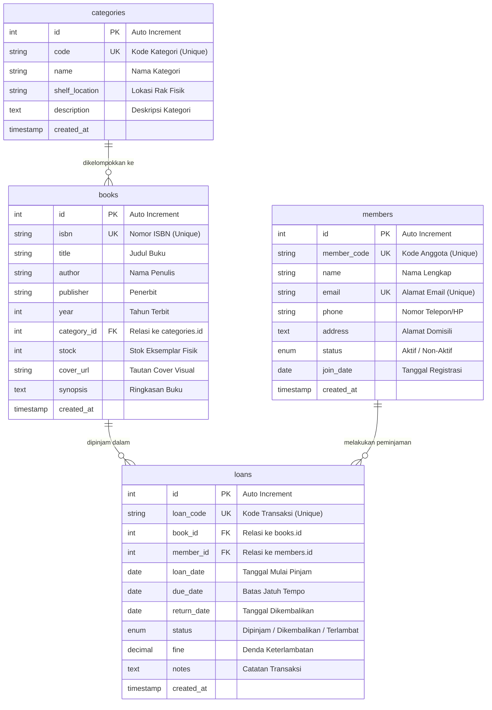

### Struktur Tabel & Atribut

#### 1. Tabel `categories`
Menampung pengelompokan jenis buku dan lokasi penataan fisik di perpustakaan.
- `id` (INT, PK, AUTO_INCREMENT): Identifikator unik kategori.
- `code` (VARCHAR(20), UNIQUE, NOT NULL): Kode klasifikasi buku (contoh: `CAT-CS`, `CAT-LIT`).
- `name` (VARCHAR(100), NOT NULL): Nama lengkap kategori (contoh: *Teknologi & Ilmu Komputer*).
- `shelf_location` (VARCHAR(50), NOT NULL): Lokasi rak penyimpanan (contoh: *Rak A-01*).
- `description` (TEXT, NULL): Penjelasan ruang lingkup kategori.

#### 2. Tabel `books`
Menampung seluruh katalog buku perpustakaan.
- `id` (INT, PK, AUTO_INCREMENT): Identifikator unik buku.
- `isbn` (VARCHAR(20), UNIQUE, NOT NULL): International Standard Book Number unik.
- `title` (VARCHAR(255), NOT NULL): Judul buku.
- `author` (VARCHAR(150), NOT NULL): Pengarang/penulis buku.
- `publisher` (VARCHAR(100), NOT NULL): Lembaga penerbit.
- `year` (INT, NOT NULL): Tahun publikasi.
- `category_id` (INT, FK, NOT NULL): Mereferensikan `categories.id` (`ON DELETE RESTRICT ON UPDATE CASCADE`).
- `stock` (INT, NOT NULL, DEFAULT 0): Jumlah ketersediaan buku fisik yang dapat dipinjam.
- `cover_url` (VARCHAR(255), NULL): URL gambar sampul buku.
- `synopsis` (TEXT, NULL): Ringkasan isi buku.

#### 3. Tabel `members`
Menampung data keanggotaan perpustakaan.
- `id` (INT, PK, AUTO_INCREMENT): Identifikator unik anggota.
- `member_code` (VARCHAR(30), UNIQUE, NOT NULL): Nomor identitas keanggotaan (contoh: `MBR-2026-001`).
- `name` (VARCHAR(150), NOT NULL): Nama lengkap peminjam.
- `email` (VARCHAR(100), UNIQUE, NOT NULL): Alamat surat elektronik.
- `phone` (VARCHAR(25), NOT NULL): Nomor WhatsApp / HP aktif.
- `address` (TEXT, NOT NULL): Alamat tempat tinggal.
- `status` (ENUM('Aktif', 'Non-Aktif'), DEFAULT 'Aktif'): Status hak pinjam anggota.
- `join_date` (DATE, NOT NULL): Tanggal terdaftar pertama kali.

#### 4. Tabel `loans`
Menampung data transaksi sirkulasi peminjaman dan pengembalian.
- `id` (INT, PK, AUTO_INCREMENT): Identifikator transaksi.
- `loan_code` (VARCHAR(35), UNIQUE, NOT NULL): Kode unik transaksi (contoh: `PINJAM-202611-001`).
- `book_id` (INT, FK, NOT NULL): Mereferensikan `books.id`.
- `member_id` (INT, FK, NOT NULL): Mereferensikan `members.id`.
- `loan_date` (DATE, NOT NULL): Tanggal awal buku dipinjam.
- `due_date` (DATE, NOT NULL): Batas waktu pengembalian buku (jatuh tempo).
- `return_date` (DATE, NULL): Tanggal aktual buku dikembalikan.
- `status` (ENUM('Dipinjam', 'Dikembalikan', 'Terlambat')): Status sirkulasi.
- `fine` (DECIMAL(10,2), DEFAULT 0.00): Nilai akumulasi denda jika melewati tanggal jatuh tempo (Rp 1.000 / hari).
- `notes` (TEXT, NULL): Catatan kondisi fisik buku saat dipinjam/dikembalikan.

---

## Struktur Direktori Proyek

```text
tp7/
├── class/                      # Berisi Kelas-Kelas Pengendali Tabel (OOP Logic)
│   ├── Book.php                # Kelas Model untuk operasi CRUD tabel 'books'
│   ├── Category.php            # Kelas Model untuk operasi CRUD tabel 'categories'
│   ├── Loan.php                # Kelas Model untuk sirkulasi & denda tabel 'loans'
│   └── Member.php              # Kelas Model untuk operasi CRUD tabel 'members'
├── config/                     # Berisi Konfigurasi Koneksi & Lingkungan Aplikasi
│   └── db.php                  # Kelas Database PDO terpusat & konfigurasi koneksi MySQL
├── database/                   # Berisi Skrip Basis Data SQL
│   └── db_pustaka_tp7.sql      # Skrip DDL pembentukan tabel & DML data uji coba
├── Dokumentasi/                # Bukti Eksekusi & Tangkapan Layar GUI Website
│   ├── 01_dashboard_utama.png
│   ├── 02_kategori_koleksi.png
│   ├── 03_modal_tambah_kategori.png
│   ├── 04_katalog_buku.png
│   ├── 05_modal_detail_buku.png
│   ├── 06_modal_tambah_buku.png
│   ├── 07_data_keanggotaan.png
│   ├── 08_modal_tambah_anggota.png
│   ├── 09_sirkulasi_peminjaman.png
│   ├── 10_modal_transaksi_pinjam.png
│   ├── 11_modal_pengembalian_buku.png
│   ├── 12_filter_katalog_buku.png
│   └── demo_crud.gif           # Animasi rekaman demonstrasi alur sistem
├── style/                      # Berisi Lembar Gaya Tampilan
│   └── style.css               # Desain antarmuka kustom (Inter typography, cards, badges)
├── view/                       # Berisi Komponen Visual & Halaman Antarmuka Modular
│   ├── books.php               # Tampilan manajemen katalog buku & modal
│   ├── categories.php          # Tampilan manajemen kategori buku & modal
│   ├── dashboard.php           # Tampilan ringkasan statistik & aktivitas sirkulasi
│   ├── footer.php              # Template penutup HTML, copyright, dan JS scripts
│   ├── header.php              # Template pembuka HTML, metadata, navbar, dan flash alert
│   ├── loans.php               # Tampilan transaksi sirkulasi peminjaman/pengembalian
│   └── members.php             # Tampilan manajemen data keanggotaan & modal
├── .gitignore                  # Berkas pengecualian file cache dan metadata editor
├── index.php                   # Titik awal masuk aplikasi (Controller & Dispatcher)
├── README.md                   # Laporan komprehensif dokumentasi tugas
└── style.css                   # Alias stylesheet akar (mengimpor style/style.css)
```

---

## Penjelasan Kelas & Alur Eksekusi (Application Flow)

### 1. Siklus Request-Response HTTP

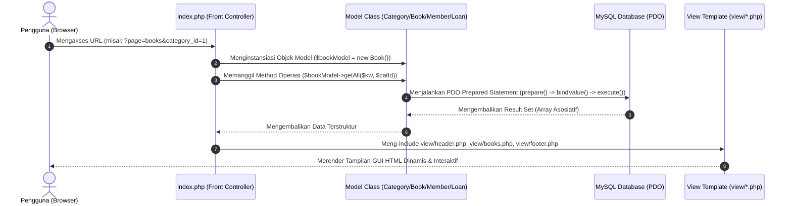

### 2. Alur Transaksi Aksi (Create / Update / Delete)

Ketika pengguna melakukan tindakan (misalnya meminjam buku):
1. **Form Submission:** Pengguna mengisi formulir modal pada antarmuka dan menekan tombol *Simpan*. Form dikirim via metode `POST` ke `index.php?page=loans&action=borrow`.
2. **Validasi & Eksekusi:** `index.php` menangkap request dan memanggil method `Loan->borrow($bookId, $memberId, $loanDate, $dueDate, $notes)`.
3. **Penerapan OOP & Transaksi:**
   - Objek `Loan` mengecek keabsahan tanggal dan status keanggotaan peminjam.
   - Menginisiasi transaksi `PDO::beginTransaction()`.
   - Mengambil stok buku terkini menggunakan kueri terkunci (`FOR UPDATE`).
   - Jika stok tersedia (> 0), data transaksi di-insert dengan kode pinjam unik yang digenerate otomatis.
   - Stok buku didekremen sebesar `-1` melalui `UPDATE books SET stock = stock - 1`.
   - Melakukan `PDO::commit()`.
4. **Flash Session & Redirect:** Hasil status operasi (`success` / `danger`) disimpan ke dalam `$_SESSION['flash']`, kemudian dialihkan via header `Location: index.php?page=loans`.
5. **Render Notifikasi:** Halaman memuat ulang dengan pesan feedback yang ramah dan data tabel yang otomatis terbarui.

---

## Fitur & Operasi CRUD Seluruh Entitas

### 1. Entitas Kategori (`categories`)
- **Create:** Menambahkan kategori baru dengan validasi keunikan kode kategori (`CAT-XXX`) dan penentuan lokasi rak.
- **Read:** Menampilkan daftar kategori, lokasi rak, deskripsi, dan kalkulasi sub-query jumlah buku yang bernaung di bawah kategori tersebut. Didukung fitur pencarian (*search bar*).
- **Update:** Mengedit informasi kode, nama, lokasi rak, dan deskripsi kategori.
- **Delete:** Menghapus kategori dengan perlindungan integritas referensial. Sistem menolak penghapusan jika kategori masih menaungi judul buku tertentu.

### 2. Entitas Buku (`books`)
- **Create:** Mendaftarkan buku baru dengan field nomor ISBN (unik), judul, pengarang, penerbit, tahun terbit, pilihan kategori dropdown, stok fisik, tautan cover visual, dan sinopsis.
- **Read:** Menampilkan katalog buku dalam format tabel visual lengkap dengan gambar cover, rincian metadata, dan badge ketersediaan stok. Tersedia filter multi-kategori dan pencarian teks judul/penulis/ISBN.
- **Detail View:** Menyediakan modal pop-up khusus yang menampilkan sinopsis lengkap, lokasi rak fisik buku, dan detail teknis penerbitan.
- **Update:** Memperbarui data informasi buku dan stok ketersediaan fisik.
- **Delete:** Menghapus buku dari sistem dengan proteksi aman terhadap data peminjaman yang sedang aktif.

### 3. Entitas Anggota (`members`)
- **Create:** Mendaftarkan anggota baru dengan kode anggota unik (`MBR-XXXX`), nama lengkap, email unik, nomor telepon, alamat domisili, status keaktifan, dan tanggal bergabung.
- **Read:** Menampilkan direktori anggota beserta badge status (*Aktif* / *Non-Aktif*) dan counter jumlah buku yang sedang dipinjam secara real-time. Tersedia fitur pencarian dan filter status.
- **Update:** Memperbarui data kontak, alamat, atau mengubah status keanggotaan.
- **Delete:** Menghapus data anggota dengan validasi pencegahan jika anggota masih memiliki tanggungan peminjaman buku yang belum dikembalikan.

### 4. Entitas Sirkulasi Peminjaman (`loans`)
- **Create (Borrow):** Memfasilitasi peminjaman buku oleh anggota aktif. Sistem hanya mengizinkan pemilihan buku yang stoknya masih tersedia (> 0). Stok buku otomatis berkurang `-1` secara atomik.
- **Read (Track):** Menampilkan seluruh riwayat dan peminjaman berjalan, lengkap dengan tanggal peminjaman, tanggal jatuh tempo, dan tanggal pengembalian.
- **Denda Dinamis & Overdue Detection:** Sistem otomatis mendeteksi jika tanggal hari ini telah melewati batas jatuh tempo (`CURDATE() > due_date`), menampilkan badge merah *Terlambat (+X hari)*, serta mengalkulasikan estimasi denda berjalan secara otomatis (Rp 1.000 / hari).
- **Update (Return / Extension):** 
  - *Proses Pengembalian:* Tombol aksi satu-klik yang membuka modal konfirmasi pengembalian, mencatat tanggal kembali, mengunci nominal denda yang harus dibayar, dan memulihkan kuantitas stok buku fisik (`+1`).
  - *Perpanjangan Waktu:* Memperbarui batas jatuh tempo atau menambahkan catatan kondisi fisik buku.
- **Delete:** Menghapus catatan arsip transaksi. Jika transaksi yang belum dikembalikan dihapus paksa, sistem secara cerdas mengembalikan stok fisik buku ke kondisi semula.

---

## Skenario Pengujian Fungsionalitas (Test Cases)

Seluruh fungsionalitas telah melalui uji coba menyeluruh (*End-to-End Functional Testing*):

| Kasus Uji | Skenario Pengujian | Input / Aksi | Ekspektasi Sistem | Hasil Aktual | Status |
| :---: | :--- | :--- | :--- | :--- | :---: |
| **TC-01** | Insert Kategori Baru | Form Tambah Kategori diisi valid | Kategori tersimpan di database, muncul notifikasi sukses | Kategori berhasil ditambahkan ke tabel | ✅ Lolos |
| **TC-02** | Validasi Duplikasi Kode Kategori | Memasukkan kode kategori yang sudah ada (`CAT-CS`) | Sistem menolak insert dan menampilkan peringatan kode duplikat | Error: Kode kategori sudah terdaftar | ✅ Lolos |
| **TC-03** | Insert Buku dengan Relasi Foreign Key | Form Tambah Buku memilih kategori dari dropdown | Buku tersimpan dengan `category_id` valid mereferensikan tabel categories | Buku berhasil disimpan dan nama kategori tampil via JOIN | ✅ Lolos |
| **TC-04** | Validasi Input Stok Buku Negatif | Memasukkan nilai stok `-5` pada form buku | Sistem menolak proses penyimpanan | Error: Jumlah stok buku tidak boleh bernilai negatif | ✅ Lolos |
| **TC-05** | Filter Katalog Buku Berdasarkan Kategori | Memilih kategori "Teknologi & Ilmu Komputer" | Tabel hanya merender buku-buku berelasi dengan kategori terpilih | Data tersaring tepat, total item diperbarui | ✅ Lolos |
| **TC-06** | Insert Transaksi Peminjaman (Borrow) | Meminjam buku dengan stok = 5 | Transaksi tercatat, stok buku fisik di database berkurang otomatis menjadi 4 | Transaksi berhasil, stok buku terpotong `-1` | ✅ Lolos |
| **TC-07** | Validasi Peminjaman Buku dengan Stok Habis | Mencoba meminjam buku yang stok fisiknya = 0 | Opsi buku dinonaktifkan / sistem menolak transaksi | Validasi aktif, transaksi ditolak dengan pesan stok kosong | ✅ Lolos |
| **TC-08** | Validasi Peminjaman oleh Anggota Non-Aktif | Memilih anggota dengan status 'Non-Aktif' | Opsi anggota dinonaktifkan / sistem menolak peminjaman | Error: Anggota berstatus Non-Aktif tidak diizinkan meminjam | ✅ Lolos |
| **TC-09** | Deteksi Keterlambatan & Kalkulasi Denda | Buku melewati jatuh tempo selama 9 hari | Status berubah dinamis menjadi 'Terlambat', denda terhitung Rp 9.000 | Badge keterlambatan dan denda Rp 9.000 tampil tepat | ✅ Lolos |
| **TC-10** | Pengembalian Buku (Return Book) | Menekan tombol "Kembali" dan mengonfirmasi pengembalian | Status transaksi menjadi 'Dikembalikan', stok buku bertambah kembali `+1` | Status terupdate 'Dikembalikan' dan stok buku pulih | ✅ Lolos |
| **TC-11** | Proteksi Hapus Kategori Berelasi (FK Safe) | Menghapus kategori yang masih memiliki koleksi buku | Penghapusan ditolak untuk melindungi integritas referensial data | Kategori gagal dihapus, muncul penjelasan ada buku terkait | ✅ Lolos |
| **TC-12** | Prepared Statement SQL Injection Test | Memasukkan payload `' OR '1'='1` pada kolom pencarian | Query dieksekusi secara aman sebagai string literal | Pencarian aman, tidak terjadi kebocoran/eksploitasi query | ✅ Lolos |

---

## Dokumentasi Antarmuka & Eksekusi Program

Berikut adalah dokumentasi tangkapan layar langsung (*live screenshots*) dari antarmuka web GUI **PustakaVerse**:

### 1. Demonstrasi Operasional CRUD Keseluruhan (Animasi GIF)
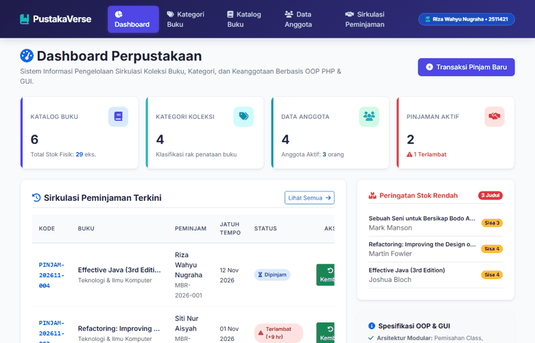

---

### 2. Dashboard Utama & Statistik Perpustakaan
Tampilan ringkasan metrik statistik koleksi, kategori, anggota, sirkulasi peminjaman aktif, indikator buku terlambat, serta daftar peringatan stok menipis:
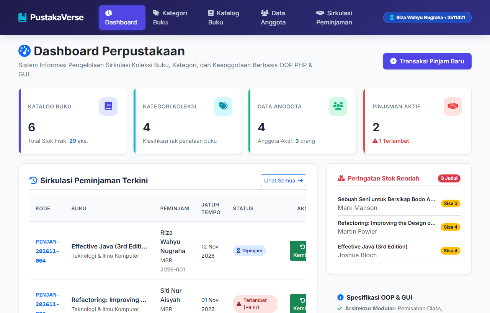

---

### 3. Manajemen Kategori Koleksi Buku (Master Categories)
Tabel master kategori buku yang menyajikan kode klasifikasi, nama kategori, lokasi rak fisik, deskripsi, dan total buku yang bernaung di bawah kategori tersebut:
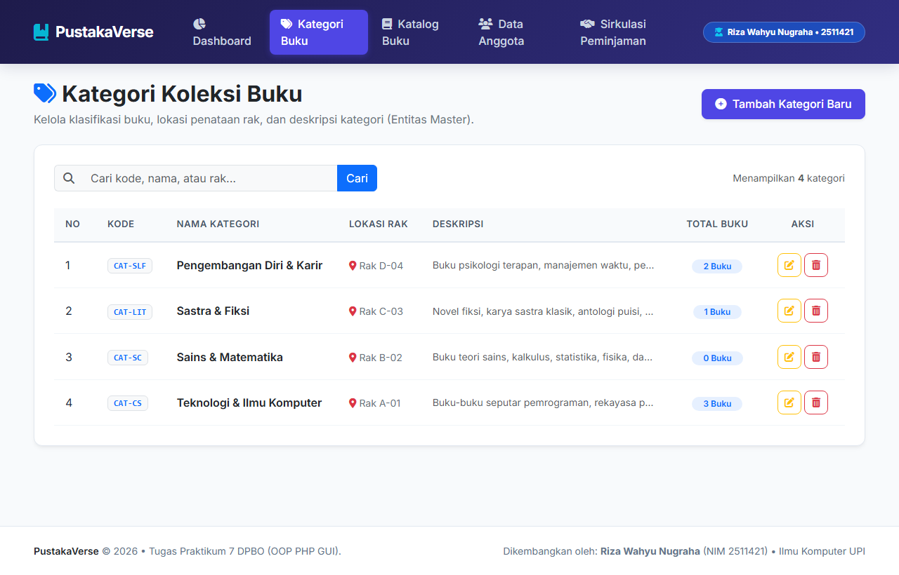

---

### 4. Formulir Modal Tambah Kategori
Antarmuka modal interaktif untuk menambahkan kategori koleksi buku baru ke database:
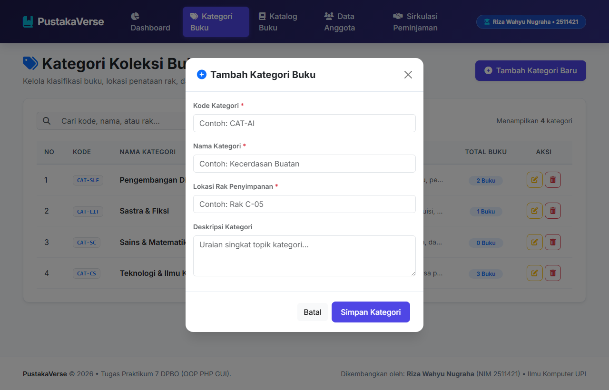

---

### 5. Katalog Koleksi Buku (Books Inventory)
Katalog inventaris buku dengan tampilan cover visual, judul, penulis, penerbit, nomor ISBN unik, tahun publikasi, dan badge ketersediaan stok fisik:
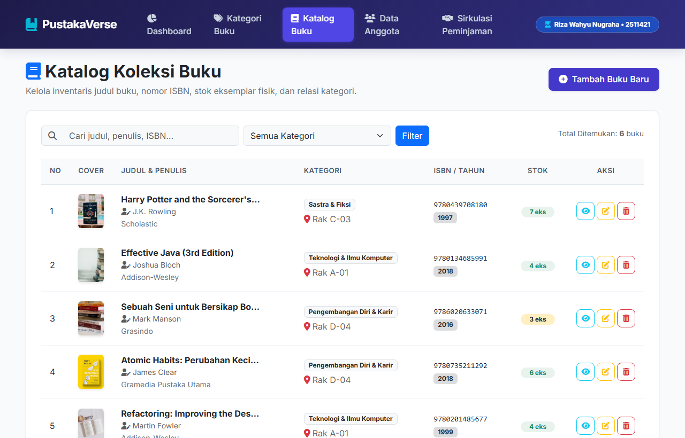

---

### 6. Modal Detail Informasi & Sinopsis Buku
Tampilan pop-up modal detail yang menyajikan sinopsis lengkap, data penerbit, nomor ISBN, serta lokasi rak penyimpanan buku:
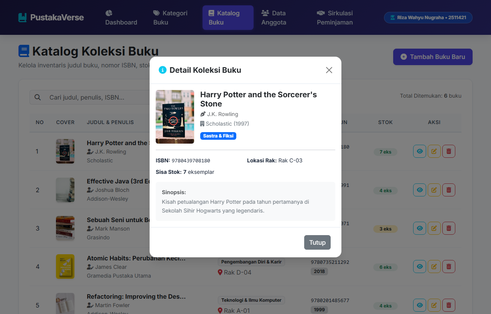

---

### 7. Formulir Modal Tambah Buku Baru
Formulir modal penambahan koleksi buku baru yang terhubung langsung dengan relasi dropdown kategori buku (*Foreign Key*):
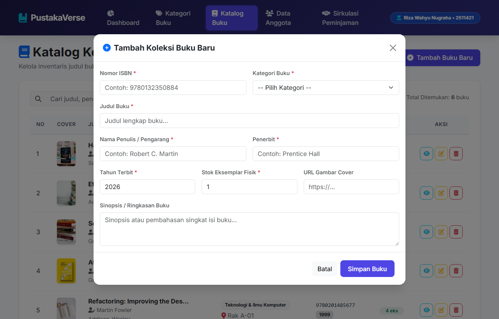

---

### 8. Manajemen Data Keanggotaan Perpustakaan (Members)
Tabel data anggota yang menampilkan kode anggota unik, nama lengkap, kontak email/WhatsApp, alamat tempat tinggal, status keaktifan, dan counter peminjaman aktif:
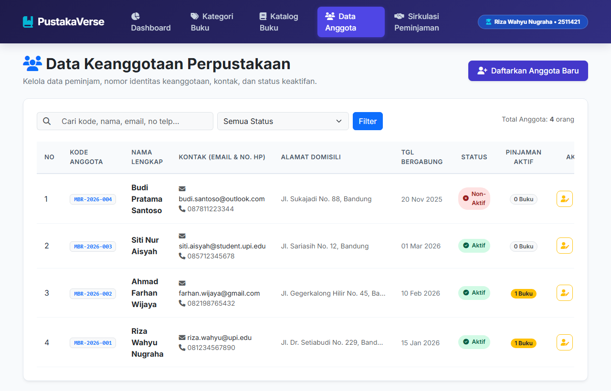

---

### 9. Formulir Modal Pendaftaran Anggota Baru
Modal form untuk meregistrasikan anggota baru perpustakaan:
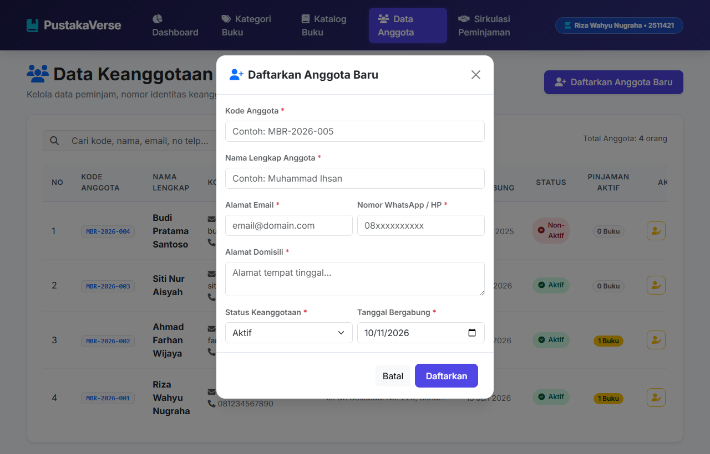

---

### 10. Sirkulasi Peminjaman & Pengembalian Buku (Loans & Circulation)
Tabel transaksi peminjaman buku yang mengintegrasikan relasi tabel buku dan anggota, dilengkapi indikator jatuh tempo, status peminjaman, serta kalkulasi denda otomatis:
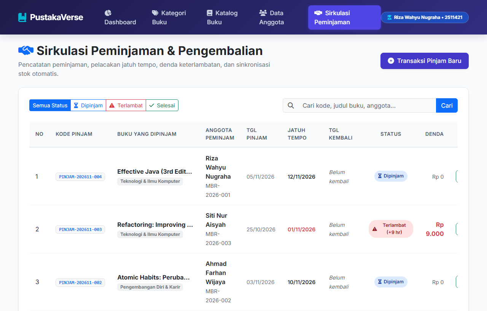

---

### 11. Formulir Modal Transaksi Peminjaman Baru (Borrow Modal)
Formulir pencatatan peminjaman buku baru dengan validasi otomatis stok ketersediaan dan status keaktifan anggota:
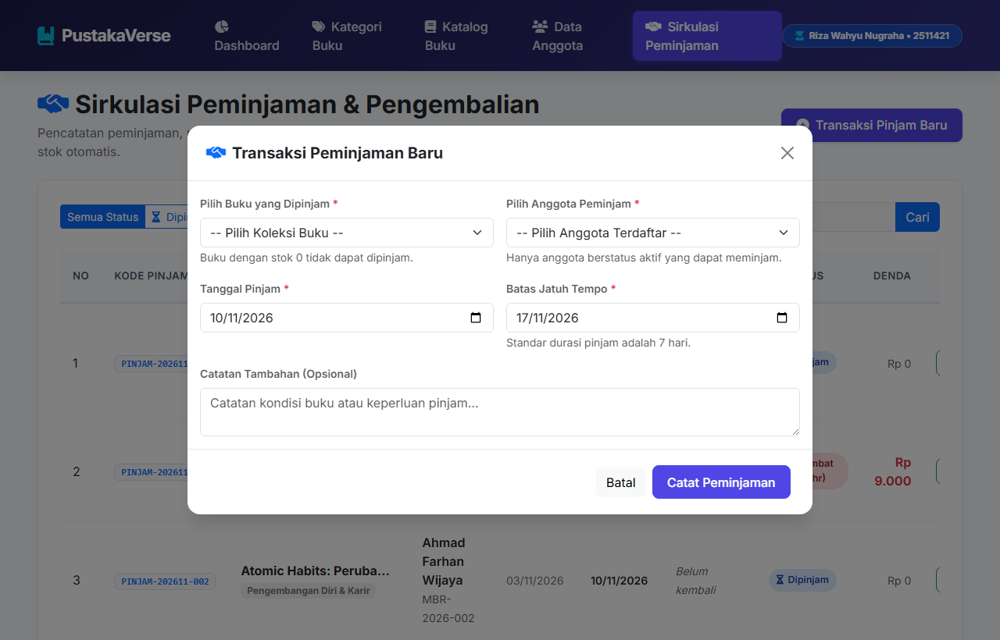

---

### 12. Modal Konfirmasi Pengembalian Buku & Pemulihan Stok
Modal interaktif untuk memproses pengembalian buku, mencatat tanggal kembali, mengunci nominal denda keterlambatan, dan memulihkan stok buku secara otomatis:
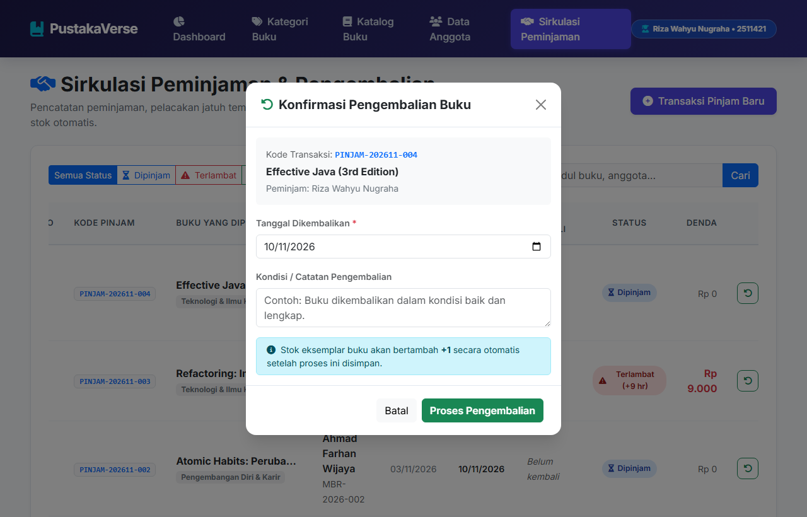

---

### 13. Fitur Filter & Pencarian Dinamis
Penggunaan fitur filter kategori terintegrasi yang menyaring katalog buku berdasarkan kategori yang dipilih:
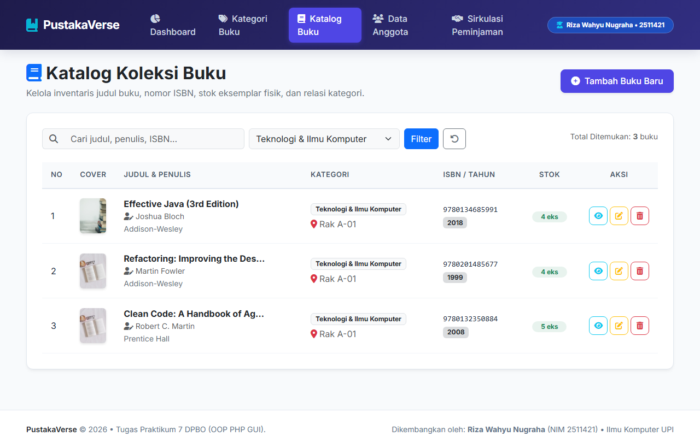

---

## Panduan Setup & Menjalankan Program

### Prasyarat Sistem
1. Web Server lokal: **Laragon** atau **XAMPP** (disarankan Apache + MySQL aktif).
2. PHP versi 7.4 ke atas (Direkomendasikan PHP 8.0 / 8.1 / 8.2+).
3. Web Browser modern (Google Chrome, Microsoft Edge, Mozilla Firefox).

### Langkah-Langkah Menjalankan

#### Opsi 1: Menggunakan Laragon / XAMPP (Direkomendasikan)
1. **Pastikan Service Menyala:**
   - Buka Control Panel Laragon atau XAMPP.
   - Nyalakan service **Apache** dan **MySQL** (pastikan berstatus hijau/running).
2. **Import Basis Data:**
   - Buka **phpMyAdmin** melalui browser pada alamat `http://localhost/phpmyadmin/`.
   - Buat database baru bernama `db_pustaka_tp7` atau langsung klik tab **Import**.
   - Pilih berkas `database/db_pustaka_tp7.sql` yang berada di dalam folder proyek ini, lalu klik **Go / Kirim**.
   - *(Alternatif via Terminal CLI):*
     ```bash
     mysql -u root -p < database/db_pustaka_tp7.sql
     ```
3. **Penempatan Direktori:**
   - Letakkan folder `tp7` ke dalam direktori root server:
     - Laragon: `C:\laragon\www\tp7`
     - XAMPP: `C:\xampp\htdocs\tp7`
4. **Buka Aplikasi pada Browser:**
   - Buka URL: `http://localhost/tp7/index.php` atau `http://localhost/tp7/`

---

#### Opsi 2: Menggunakan PHP Built-in Server
Jika ingin menjalankan secara instan tanpa memindahkan direktori kerja:
1. Pastikan service **MySQL** di Laragon/XAMPP sudah menyala dan database `db_pustaka_tp7` sudah diimpor.
2. Buka terminal (PowerShell / Command Prompt / Git Bash) tepat di dalam folder `tp7`:
   ```bash
   cd "c:\Users\Riza Wahyu Nugraha\Documents\coolyeah\persemester\sem-3\DPBO\tp7"
   ```
3. Jalankan perintah server lokal PHP:
   ```bash
   php -S localhost:8000
   ```
4. Buka peramban web dan akses alamat:
   ```text
   http://localhost:8000
   ```

---

## Troubleshooting & FAQ

1. **Muncul pesan "Koneksi Database Gagal: SQLSTATE[HY000] [1049] Unknown database 'db_pustaka_tp7'"**
   - *Penyebab:* File SQL database belum dieksekusi di server MySQL.
   - *Solusi:* Impor file `database/db_pustaka_tp7.sql` melalui phpMyAdmin atau jalankan query pembuatannya.

2. **Password database lokal berbeda (bukan root tanpa password)**
   - *Penyebab:* Pengaturan kredensial default MySQL pada mesin pengguna memiliki kata sandi kustom.
   - *Solusi:* Buka file `config/db.php`, kemudian sesuaikan nilai variabel `$username`, `$password`, atau `$host` sesuai konfigurasi lokal Anda:
     ```php
     private $host = "localhost";
     private $username = "root";
     private $password = "password_anda";
     private $dbname = "db_pustaka_tp7";
     ```

3. **Stok buku tidak berkurang saat peminjaman?**
   - *Penyebab:* Mekanisme transaksi database membutuhkan dukungan engine InnoDB.
   - *Solusi:* Tabel-tabel pada `db_pustaka_tp7.sql` telah secara baku dikonfigurasikan menggunakan `ENGINE=InnoDB`. Pastikan MySQL Anda mendukung penyimpanan InnoDB (aktif secara default pada seluruh instalasi XAMPP dan Laragon modern).

---

*Hak Cipta © 2026 Riza Wahyu Nugraha (NIM 2511421). Tugas Praktikum 7 Desain dan Pemrograman Berorientasi Objek.*

